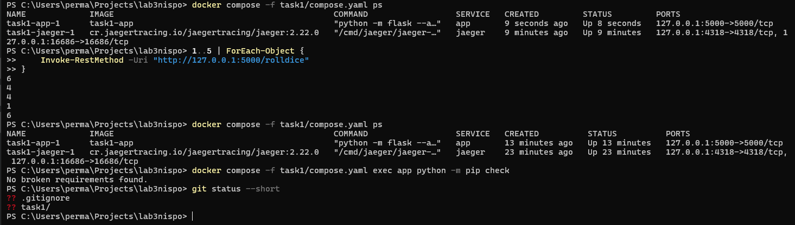
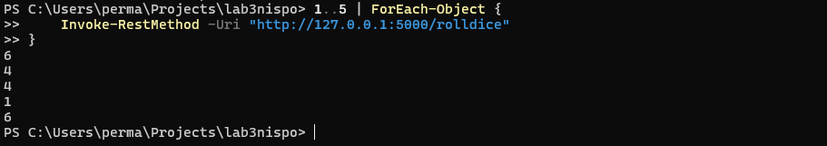
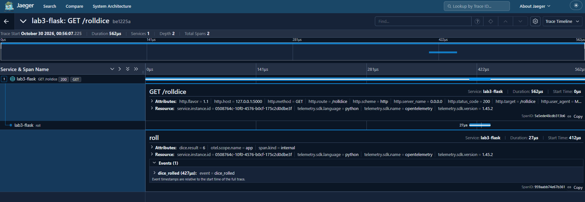

# Лабораторная работа № 3

Мониторинг в распределённых системах. Дисциплина «Непрерывное интегрирование и сборка программного обеспечения».

## Автор

**Атаев Перман**, Белорусский государственный университет, факультет прикладной математики и информатики, 4 курс, группа 13.

## Отчёт и задание

[Открыть PDF-отчёт со скриншотами и ответами на 16 контрольных вопросов](docs/report.pdf).

Для группы 13 выполнено **задание 1**: Flask, OpenTelemetry, Jaeger и Docker Compose. Код и конфигурация находятся в [task1](task1/).

## Запуск

Требуются Git и работающий Docker с Compose; в Windows используется Docker Desktop с Linux-контейнерами.

```powershell
git clone https://github.com/PermanAtayevv/lab3nispo.git
cd lab3nispo
docker compose -f task1/compose.yaml up -d --build
```

- Приложение: http://127.0.0.1:5000/rolldice
- Jaeger: http://localhost:16686

```powershell
docker compose -f task1/compose.yaml ps
docker compose -f task1/compose.yaml exec app python -m pip check
1..5 | ForEach-Object {
    Invoke-RestMethod -Uri "http://127.0.0.1:5000/rolldice"
}
```

Подождите 5–10 секунд. В Jaeger выберите `lab3-flask`, нажмите **Find Traces** и откройте новый запрос. Ожидаются `GET /rolldice` и дочерний span `roll` с атрибутом `dice.result` и событием `dice_rolled`.

## Устройство стенда

Flask создаёт HTTP-span через `FlaskInstrumentor`; функция `roll` добавляет собственный span. `BatchSpanProcessor` отправляет данные через OTLP/HTTP на `http://jaeger:4318/v1/traces`. Имя `jaeger` — имя сервиса в сети Compose.

| Файл | Назначение |
|---|---|
| `task1/app.py` | Приложение и трассировка |
| `task1/requirements.txt` | Зафиксированные Python-зависимости |
| `task1/Dockerfile` | Сборка приложения |
| `task1/compose.yaml` | Приложение и Jaeger |
| `task1/.dockerignore` | Исключения из контекста сборки |
| `docs/report.pdf` | Отчёт |
| `docs/images/` | Скриншоты проверок |

## Результаты проверок

Оба контейнера запущены; `pip check` сообщает `No broken requirements found.`



Пять запросов вернули `6, 4, 4, 1, 6` — все значения находятся в диапазоне 1–6.



Трассировка контейнеризированного приложения содержит два span, HTTP 200, `dice.result = 6` и событие `dice_rolled`. Длительность выбранного запроса — 562 мкс, span `roll` — 27 мкс. Это результат одного запроса, а не нагрузочный тест.



## Журналы и остановка

```powershell
docker compose -f task1/compose.yaml logs --tail 80 app jaeger
docker compose -f task1/compose.yaml down
```

Учебный стенд использует сервер разработки Flask. Jaeger хранит трассировки в памяти: при перезапуске процесса они теряются. `depends_on` задаёт порядок запуска, но не проверяет готовность приёмника. Задания 2 и 3 (метрики и централизованный сбор логов) не входят в объём группы 13.

## Репозиторий

https://github.com/PermanAtayevv/lab3nispo
